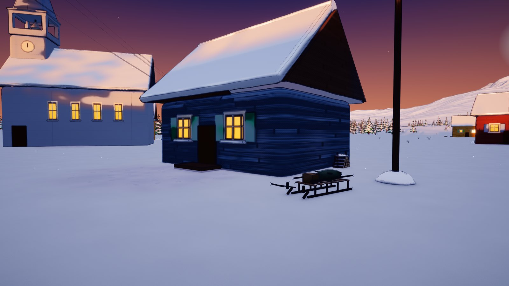
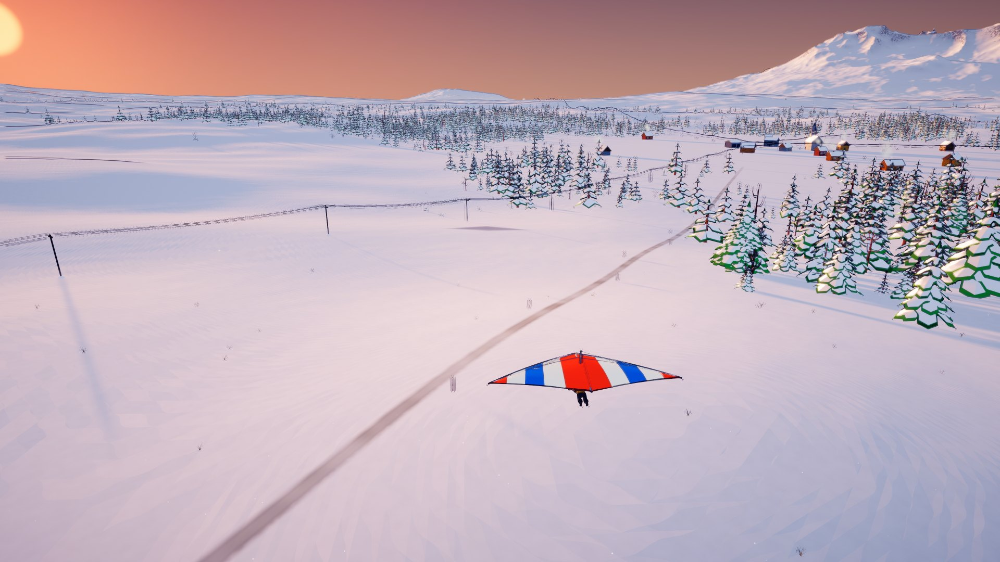
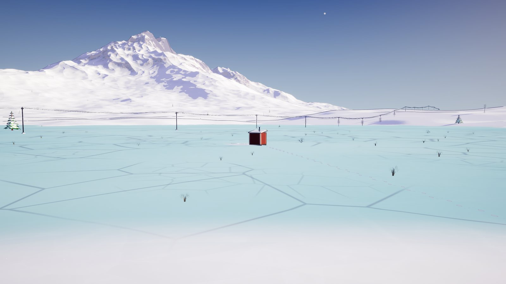

# Guérilla — Vetrarhríð

*Nivôse: an island locked in ice, eight geothermal drill rigs, and a partisan war fought on skis.*

*Nivôse, une île sous la glace, huit forages, et une guerre de partisans à skis.*

**[English](#en)** · **[Français](#fr)**

<p>



</p>

---

<a id="en"></a>
## English

A turn-based strategy game played on a command map, combined with first-person 3D combat. You lead the Hamlet Guard against the armored columns of the Concession, which wants to seize the geothermal drill rigs that keep the island warm. The whole game is drawn like a comic book, in the clear-line style: inked outlines, flat tones, lavender shadows.

**In development** · Mac, Windows, iPad and iPhone · English and French · Studio Thelba · **free** on itch.io, Steam and the App Store, with an optional Premium Pack

> The browser version (`Guerilla.html`) and the Mac app made from it no longer exist. Guérilla is now a native game made with Unity.

---

### Rulebook

The rulebook covers the whole game: the aim of the game, victory and defeat, difficulty levels, the free game, what each recruit skill is for, wildlife, the Premium Pack, the editor, every control, a controls summary and an index. **Tip** boxes along the way give players' advice: how to approach a post, when to sabotage, how to stay out of sight.

- **Read online**: [Rulebook (English)](https://zedoc84.github.io/Guerilla-public/Guerilla-Rulebook-EN.html) · [Livret de règles (français)](https://zedoc84.github.io/Guerilla-public/Guerilla-Livret-de-regles-FR.html)
- **PDF**, to print or keep: [Guerilla-Rulebook-EN.pdf](Guerilla-Rulebook-EN.pdf) · [Guerilla-Livret-de-regles-FR.pdf](Guerilla-Livret-de-regles-FR.pdf)

The online version works on a computer or a phone. It is a single page: save it from your browser to read it offline.

The game also has its own manual: **How to play**, on the title screen and in the menu.

---

### Free game and Premium Pack

**Guérilla is free**, with no trial and no time limit: on itch.io and Steam (Mac and Windows) and on the App Store (Mac, iPad and iPhone). The **Premium Pack** is optional: a single purchase, sold as an add-on on Steam, as an in-app purchase on the App Store (valid on Mac, iPad and iPhone with the same Apple account) and with a key on itch.io.

#### The free game

- **The island of Nivôse** and its whole campaign: 40 km across, fifteen hamlets, eight drill rigs, four Concession installations, the Brisante gorge, three cable cars, four airstrips.
- **32 recruits**, each with a home hamlet, skills, a story and ties to others.
- **Four levels of winter severity** (Mild, Harsh, Severe, Deadly) and options: aircraft-guided mortars, attack fighter, fog of war, guided first mission.
- **The command map and the 3D view** in first person.
- **The Duel**: a short game, 10 to 15 minutes, your hero alone against an AI rival.
- **Life on the island**: wildlife, tracks, camps, frozen lakes (see Features).
- **Autosave**, save slots, game export and import.

#### The Premium Pack adds

- **The outside view**: the isometric view (your recruit shows through roofs and trees), the camera behind the commander and the rear view when driving.
- **Advanced campaign**: Krag's general staff answers every blow you strike.
- **The daily challenge**: the same game for everyone, every day.
- **Random island**: new terrain, hamlets and installations placed differently, a random start; 40, 10 or 5 km across. Each island has a number; **Draw another island** offers a new one.
- **Island of the day**: the same random island and the same rules for everyone, every day.
- **Real map**: any place in the world, from OpenStreetMap: the terrain, the villages and their real buildings, roads, rivers, lakes, forests, airfields and bridges. Type a name (Chamonix, Mont Ventoux, Lofoten…) or coordinates, and choose 20, 40 or 60 km. **City maps** (City 5 km or City 10 km) load every building, with passers-by, traffic, cars you can drive and famous monuments.
- **Ten more partisans**: 42 recruits instead of 32.
- **Pickup truck**: one per garage (0 to 2 in the editor). It drives through the snow and up the slopes depending on the ground, carries up to four recruits in the back, who can fall off if you drive too fast, and changes travel on the command map: those who ride together leave and arrive together. Left out in the field, it can be shot up or blown up.
- **Ski plane**: a Harfang bush plane next to each mountain hut (0 to 2 in the editor). It takes off and lands anywhere flat (250 m of snow under 8 %, frozen lakes and sea ice included, never thin ice), and flies its pilot and up to three passengers anywhere on the map.
- **The Raid** (coming soon): an operation of about an hour with your squad, in three acts (preparation, action, withdrawal), and the **duel of the day**.
- **Editor**: move hamlets, installations and airstrips, add or remove buildings, post patrols, set the commander's start, write a scenario, choose the starting recruits, and test any spot in 3D.
- **My maps**: keep your maps, export them as `.carte-guerilla.json` files and import other players' maps.
- **Stream Deck** (Mac and Windows): the plugin shows the game's state and controls it.

#### Other eras

The same engine carries other eras, each sold on its own, separately from the Premium Pack, inside the Guérilla app. First up: **the West**, a valley in Wyoming in 1885, with its own campaign and modes.

---

### Game modes

- **Campaign**: the whole war for the island, turn by turn on the command map and in 3D on the ground. Classic in the free game, Advanced with the Premium Pack.
- **Duel** (10–15 min, free): your hero alone against an AI rival on a small arena, in two winning rounds out of three. Pick a weapon and an item from three cards, track your rival by footprints, noise and smoke, and beat the blizzard that shrinks the arena; if you are both still standing, it ends face to face.
- **Raid** (about 1 hour, Premium Pack, coming soon): your hero and two or three recruits on a single operation, such as a convoy ambush, a sabotage or the defense of a village.

---

### Download and install

**On itch.io**: [thelba.itch.io/guerilla](https://thelba.itch.io/guerilla) · coming soon on Steam and on the App Store.

For beta testers: `[DOWNLOAD LINK]`

| File | For |
|---|---|
| `Guerilla-Beta-[VERSION]-Mac.zip` | Mac with Apple silicon (M1 and later) or Intel |
| `Guerilla-Beta-[VERSION]-Windows.zip` | Windows 10 or 11, 64-bit |

**Beta builds have everything unlocked, with no key to enter.** You need a keyboard and mouse; a controller works in the 3D view. The game plays offline: only downloading a real map needs an Internet connection.

#### Mac

1. Open the .zip and drag **Guérilla** into your **Applications** folder.
2. The game is not yet signed by Apple, so macOS refuses to open it the first time. Open **System Settings > Privacy & Security**, scroll down to the message about **Guérilla**, click **Open Anyway** and confirm.
3. If macOS says the app "is damaged", open Terminal and type:
   ```
   xattr -dr com.apple.quarantine /Applications/Guérilla.app
   ```
   Then launch the game again.

#### Windows

1. Right-click the .zip, choose **Extract All…** and pick a folder.
2. Run **Guerilla.exe**. Keep the other files and folders next to it.
3. The game is not yet signed: if Windows shows "Windows protected your PC", click **More info**, then **Run anyway**.

#### Language

The game starts in your system's language (English or French). Change it on the title screen, in the **Language** row (**Automatic**, **Français** or **English**), or from the menu during a game.

#### Where are my saves?

Games, settings and your maps stay on your computer, and carry over from one beta to the next. The game saves itself at every important step, every five minutes in 3D and when you quit. To move a game to another computer: **Menu > Export game** (a text to copy), then **Import** on the title screen.

---

### Features

- **Time**: each turn lasts two hours for each member of the Guard. Play them one after another, then **Synchronize watches**: the Concession takes its turn.
- **Recruiting**: each islander only follows certain people (a brother, a fiancée, an old friend…).
- **Getting around**: realistic skiing (about 5 km/h on the flat), on foot, by snowmobile or in tow, by cable car, hang glider and plane, with a parachute and an autopilot for landing. A snowmobile stays wherever you leave it, and anyone who can drive takes it back; you can jump out of a moving vehicle, or out of a cable car (mind the height).
- **Fighting**: knife, 9 mm pistol, submachine gun, assault rifle, pump-action shotgun, scoped rifle, bazooka, grenades and charges. Stand, crouch or go prone, lean out from cover, shoot from a belfry. Only the bazooka and grenades stop a tank. Grenades are aimed: the game freezes and a ring shows where they will land. They also bring down Concession buildings: from 3 grenades (workshop) to 8 (synthesis plant), and 3 for a house in a hamlet the Concession holds.
- **Squad**: recruits in the same place follow you in 3D. Give them orders and carry a wounded comrade.
- **Garrisons, prison and escape, trackers and dogs**; firing on the Guard or on islanders has consequences.
- **Sabotage**: telegraph lines, the Brisante bridges, the depot, the tank plant, the radio relay, guard posts.
- **Weather and survival**: snow, storms and fog come and go; cold, hunger, frostbite and avalanches. Falling snow and wind wipe out tracks, yours and those the trackers follow. Light a campfire or dig a snow shelter.
- **Thin ice**: it cracks first; if it gives way, you come out with a broken leg, unable to move, and only a distress flare will bring help.
- **Wildlife**: foxes, reindeer and crows flee as you come near and at every gunshot. Crows taking off can bring the nearest soldiers over to look.
- **Life on the island**: windsocks and pennants follow the real wind, campfires and sleds mark the villages the Guard holds, crates and pennants those of the Concession; fishing huts on the frozen lakes, marked trails, snow fences.
- **Binoculars**: ×2 to ×16 zoom, night and thermal vision, rangefinder.
- **Fog of war**: the map only shows what your recruits and friendly hamlets can see.
- **A comic-book winter**: the clear-line style over the whole island, with faceted mountains and rocky spires above the cable cars, tiered snow-laden firs, restyled hamlets, cable cars and town cars.
- **Winning**: blow up the Bastion, or destroy the tank plant and rout every column. You lose if the Concession holds all eight drill rigs, or if no one is left in the Guard.

---

### Controls

The game follows the **position** of the keys: **W A S D** on QWERTY, **Z Q S D** on AZERTY. Lean with **Q / E** on QWERTY, **A / E** on AZERTY. The other letters are the same on both keyboards. **How to play** shows the keys of your own keyboard.

#### On the map

| Action | Key |
|---|---|
| Select a recruit, a place, a destination; open a card | click |
| Go to the chosen destination | Enter |
| Cancel the route, close a window | Esc |
| Next recruit | N |
| Switch to 3D view | 3 |
| Zoom | mouse wheel, or + − buttons |

#### In the 3D view

| Action | QWERTY | AZERTY |
|---|---|---|
| Push on the poles · on foot: forward | W | Z |
| Snowplow (brake) · on foot: back | S | S |
| Turn on skis · on foot: sidestep | A / D | Q / D |
| Speed tuck · on foot: run (hold) | Shift | Maj |
| Look around | mouse or arrows | souris ou flèches |
| Lean left / right (hold) | Q / E | A / E |
| Crouch, then prone | C | C |
| Stand up · jump | Space | Espace |
| Skis off, skis on | I | I |
| Climbing skins · fix a binding | P · U | P · U |
| Fire | left click | clic gauche |
| Aim · throw the knife | right click | clic droit |
| Weapons · bazooka | 1 … 6 · 7 | 1 … 6 · 7 |
| Next weapon | mouse wheel | molette |
| Reload | R | R |
| Fire mode | B | B |
| Knife strike | V | V |
| Grenade: aim (the game freezes, the ring follows the mouse) · throw · keep it | G · left click · right click or Esc | G · clic gauche · clic droit ou Échap |
| Interact: door, islander, menu, vehicle, comrade, charge, telegraph | F | F |
| Get out of a snowmobile, pickup or cable car · while moving: jump (twice within two seconds) | F F | F F |
| Binoculars · night, thermal vision | J · N | J · N |
| 3D view ↔ isometric view (Premium Pack) | Y | Y |
| Light, smother a campfire | H | H |
| Eat | X | X |
| Snow shelter | K | K |
| Squad order · fire discipline | O · L | O · L |
| Fast time ×4 | T | T |
| Distress flare (when unable to move) | Z or F | W ou F |
| Back to the map | M or Tab | M ou Tab |
| Pause | Esc | Échap |

#### Isometric view (Premium Pack)

| Action | Control |
|---|---|
| Move · fire | click the ground · click an enemy |
| Move toward the pointer (on foot you stop when you let go; on skis and in vehicles you coast on) | hold left click |
| Brake; when stopped, in a vehicle, reverse | right click |
| Go toward the top, left, bottom or right of the screen · run · reverse when stopped | W A S D (Z Q S D on AZERTY) · Shift · Space |
| Camera, zoom | arrows, mouse wheel |
| Camera behind the commander | B |
| Aimed grenade (the ring starts under the pointer) · aim at the enemy under the cursor | G · V |

#### Vehicles, plane and parachute

| Action | QWERTY | AZERTY |
|---|---|---|
| Snowmobile, car, pickup: speed up · brake (car, pickup: reverse) | W · S | Z · S |
| Snowmobile, car, pickup: turn | A / D | Q / D |
| Get in, get out (car), be towed | F | F |
| Pickup: handbrake | Space | Espace |
| Pickup, stopped: squad into the back, then out | E | E |
| Hang glider: dive · pull up · bank | W · S · A / D | Z · S · Q / D |
| Plane, cockpit: throttle | W / S | Z / S |
| Plane, cockpit: bank · pull up, dive | A / D or ← → · ↑ ↓ | Q / D ou ← → · ↑ ↓ |
| Plane, outside view: climb, dive · bank | W / S · A / D | Z / S · Q / D |
| Plane, outside view: throttle | hold left or right click, or Shift / Ctrl | clic gauche ou droit maintenu, ou Maj / Ctrl |
| Wheel brakes | Space | Espace |
| Autopilot landing (within 3 km of an airstrip; again to disengage) | L | L |
| Bail out (twice within two seconds) | F F | F F |
| Open the parachute | Space | Espace |
| Parachute: turn · speed up · brake | A / D · W · S | Q / D · Z · S |
| Rappel down from a roof | F | F |

#### Controller (3D view)

| Action | Button |
|---|---|
| Move · look | left stick · right stick |
| Jump, stand up | A |
| Moving: speed tuck · standing still: go down one position | B |
| Interact | X |
| Next weapon · previous, next weapon | Y · D-pad ← → |
| Fire mode · knife strike (with binoculars: zoom) | D-pad ↑ · D-pad ↓ |
| Aim · fire | left trigger · right trigger |
| Grenade (hold: aim with the right stick · release: throw · B: keep it) · binoculars | left bumper · right bumper |
| Fast time · campfire | left stick click · right stick click |
| Map · pause | View (Select) · Menu (Start) |

In isometric view, the left stick pushes toward the direction on screen; the **Movement in outside view** setting (title screen and menu) switches between *Toward the screen* and *Like the vehicle*, for the controller, the keyboard and the mouse.

#### Editor (Premium Pack)

| Action | Key |
|---|---|
| Undo | Ctrl+Z (Cmd+Z on Mac) |
| Redo | Ctrl+Shift+Z or Ctrl+Y |
| Remove the selected item | Delete |
| Finish · abandon a patrol round | Enter · Esc |

---

### Tips

- **For a first game**, pick **Mild** and switch on the **guided first mission** on the title screen: two columns at the start, less accurate soldiers, no air threats.
- **If the game runs slowly**, lower the **Graphics quality** in the menu (Low, Medium, High).
- **Read the islanders' files** before you try to recruit them, and send the right person: a brother or an old friend succeeds where the best speaker fails.
- **At night** (6 pm to 6 am), the columns make camp: the best time for sabotage.
- **Go for the command vehicle**, circled in white: destroying it routs the whole column.
- **A snowmobile can be heard from afar**: leave it a few kilometers from your target and finish on skis.
- **A forest doesn't hide you**: soldiers see between the trees. Put a building, a rock or a ridge between them and you.
- **Approach dogs with the wind in your face**: your scent drifts away behind you. The windsocks and pennants show where the wind blows.
- **Go round the crows** on the snow near an enemy post: if they take off, the soldiers come out to look.
- **Turn back when the ice cracks**: once it gives way, only the distress flare can save you.
- **Cut the telegraph** before attacking a post: it can no longer call its neighbors for help.

More tips in the rulebook, chapter by chapter.

---

### Credits and licenses

Design, the island of Nivôse, story and rules: original creation by Studio Thelba. Sounds and music are synthesized by the game.

- **Weapon and arm modeling**: Baptiste Barbe, 3D artist — [artstation.com/barbe_baptiste](https://www.artstation.com/barbe_baptiste)
- **Characters, animals and nature**: Toon Shooter Game Kit, Ultimate Animated Animals, Ultimate Nature Pack and Survival Pack by Quaternius (CC0); recruit heads and portraits, and the details of life on the island, by Studio Thelba.
- **Signpost**: Direction_Wood_2, from "Into The Wild" by Atomic Realm.
- **Town cars and pickup truck**: “Low Poly Vehicles – Optimized Package” by Awbmecreations (Unity Asset Store). **Textures**: Poly Haven and ambientCG (CC0).
- **Fonts** (SIL Open Font License 1.1): Barlow Semi Condensed, Big Shoulders Display, Cormorant Garamond, Cormorant SC, Noto Sans Math, Noto Sans Symbols 2.
- **Real maps**: places, buildings, roads, rivers, lakes, forests, airfields and bridges © OpenStreetMap contributors (ODbL); terrain from Terrain Tiles (Mapzen, AWS Open Data) and their sources; place search by Photon (komoot) and Nominatim.
- Made with **Unity**; models prepared with **Blender**.

The full list is in the game: **Credits and licenses**, at the bottom of the title screen.

© 2026 Studio Thelba — all rights reserved.

---

<a id="fr"></a>
## Français

Jeu de stratégie au tour par tour sur une carte d'état-major, et de combat à la première personne en 3D. Vous commandez la Garde des Hameaux contre les colonnes blindées de la Concession, qui veut s'emparer des forages géothermiques qui chauffent l'île. Tout le jeu est dessiné comme une bande dessinée, en ligne claire : contours encrés, aplats de couleur, ombres lavande.

**En développement** · Mac, Windows, iPad et iPhone · français et anglais · Studio Thelba · **gratuit** sur itch.io, Steam et l'App Store, avec un Pack Premium facultatif

> La version navigateur (`Guerilla.html`) et l'application Mac qui en était tirée n'existent plus. Guérilla est désormais un jeu réalisé avec Unity.

---

### Livret de règles

Le livret présente tout le jeu : le but du jeu, la victoire et la défaite, les niveaux de jeu, le jeu gratuit, le rôle de chaque compétence des recrues, la faune, le Pack Premium, l'éditeur, toutes les commandes, un récapitulatif des commandes et un index. Au fil des chapitres, des encadrés **Conseil** donnent des astuces de joueur : comment approcher un poste, quand saboter, comment rester hors de vue.

- **Lire en ligne** : [Livret de règles (français)](https://zedoc84.github.io/Guerilla-public/Guerilla-Livret-de-regles-FR.html) · [Rulebook (English)](https://zedoc84.github.io/Guerilla-public/Guerilla-Rulebook-EN.html)
- **PDF**, à imprimer ou à garder : [Guerilla-Livret-de-regles-FR.pdf](Guerilla-Livret-de-regles-FR.pdf) · [Guerilla-Rulebook-EN.pdf](Guerilla-Rulebook-EN.pdf)

La version en ligne se lit sur ordinateur comme sur téléphone. C'est une seule page : enregistrez-la depuis votre navigateur pour la lire hors connexion.

Le jeu a aussi son propre manuel : **Comment jouer**, sur l'écran titre et dans le menu.

---

### Jeu gratuit et Pack Premium

**Guérilla est gratuit**, sans essai ni limite de temps : sur itch.io et Steam (Mac et Windows) et sur l'App Store (Mac, iPad et iPhone). Le **Pack Premium** est facultatif : un achat unique, vendu en contenu additionnel sur Steam, en achat intégré sur l'App Store (valable sur Mac, iPad et iPhone avec le même compte Apple) et par clé sur itch.io.

#### Le jeu gratuit

- **L'île de Nivôse** et toute sa campagne : 40 km de côté, quinze hameaux, huit forages, quatre installations de la Concession, la gorge de la Brisante, trois téléphériques, quatre pistes d'aviation.
- **32 recrues**, chacune avec son hameau, ses compétences, son histoire et ses liens.
- **Quatre rigueurs de l'hiver** (Doux, Rude, Rigoureux, Mortel) et des options : mortiers guidés par avion, chasseur d'attaque, brouillard de guerre, première mission guidée.
- **La carte d'état-major et la vue 3D** à la première personne.
- **Le Duel** : une partie courte, de 10 à 15 minutes, votre héros seul face à un rival dirigé par l'IA.
- **La vie de l'île** : faune, traces, camps, lacs gelés (voir Fonctionnalités).
- **Sauvegarde automatique**, emplacements de sauvegarde, export et import des parties.

#### Ce qu'ajoute le Pack Premium

- **La vue extérieure** : la vue isométrique (votre recrue se voit à travers les toits et les sapins), la caméra derrière le commandant et la vue arrière en voiture.
- **Campagne avancée** : l'état-major de Krag répond à chacun de vos coups.
- **Le défi du jour** : la même partie pour tout le monde, chaque jour.
- **Île aléatoire** : un relief neuf, des hameaux et des installations répartis autrement, un départ tiré au sort ; 40, 10 ou 5 km de côté. Chaque île porte un numéro ; **Tirer une autre île** en propose une nouvelle.
- **Île du jour** : la même île aléatoire et les mêmes règles pour tout le monde, chaque jour.
- **Carte réelle** : n'importe quel lieu du monde, d'après OpenStreetMap : le relief, les villages et leurs vrais bâtiments, les routes, rivières, lacs, forêts, aérodromes et ponts. Tapez un nom (Chamonix, mont Ventoux, Lofoten…) ou des coordonnées, et choisissez 20, 40 ou 60 km. Les **cartes de ville** (Ville 5 km ou Ville 10 km) chargent tous les bâtiments, avec passants, circulation, voitures à conduire et monuments célèbres.
- **Dix partisans de plus** : 42 recrues au lieu de 32.
- **Pick-up** : un par garage (de 0 à 2 dans l'éditeur). Il roule dans la neige et monte les pentes selon le sol, emmène jusqu'à quatre recrues à l'arrière, qui peuvent tomber si l'on roule trop vite, et change les trajets sur la carte d'état-major : ceux qui voyagent ensemble partent et arrivent ensemble. Laissé en campagne, il craint les balles et les explosions.
- **Avion à skis** : un Harfang, avion de brousse, près de chaque refuge (de 0 à 2 dans l'éditeur). Il décolle et se pose partout où c'est plat (250 m de neige à moins de 8 %, lacs gelés et banquise compris, jamais la glace mince), et emmène son pilote et jusqu'à trois passagers n'importe où sur la carte.
- **Le Coup de main** (bientôt) : une opération d'environ une heure avec votre escouade, en trois actes (préparation, action, repli), et le **duel du jour**.
- **Éditeur** : déplacez hameaux, installations et pistes, ajoutez ou retirez des bâtiments, postez des patrouilles, choisissez le départ du commandant, écrivez un scénario, choisissez les recrues de départ, et testez n'importe quel endroit en 3D.
- **Mes cartes** : gardez vos cartes, exportez-les en fichier `.carte-guerilla.json` et importez celles des autres joueurs.
- **Stream Deck** (Mac et Windows) : le plugin affiche l'état de la partie et la pilote.

#### Les autres époques

Le même moteur porte d'autres époques, vendues chacune à part, indépendamment du Pack Premium, dans l'application Guérilla. La première : **l'Ouest**, une vallée du Wyoming en 1885, avec sa propre campagne et ses modes.

---

### Les modes de jeu

- **Campagne** : toute la guerre pour l'île, au tour par tour sur la carte d'état-major et en 3D sur le terrain. Classique dans le jeu gratuit, Avancée avec le Pack Premium.
- **Duel** (10 à 15 min, gratuit) : votre héros seul face à un rival dirigé par l'IA, sur une petite arène, en deux manches gagnantes sur trois. Choisissez une arme et un objet parmi trois cartes, traquez votre rival à ses traces, au bruit et à la fumée, et devancez le blizzard qui resserre l'arène ; si vous êtes encore debout tous les deux, tout se règle en face-à-face.
- **Coup de main** (environ 1 h, Pack Premium, bientôt) : votre héros et deux ou trois recrues pour une seule opération, comme une embuscade de convoi, un sabotage ou la défense d'un village.

---

### Télécharger et installer

**Sur itch.io** : [thelba.itch.io/guerilla](https://thelba.itch.io/guerilla) · bientôt sur Steam et sur l'App Store.

Pour les testeurs de la bêta : `[LIEN DE TÉLÉCHARGEMENT]`

| Fichier | Pour |
|---|---|
| `Guerilla-Beta-[VERSION]-Mac.zip` | Mac à puce Apple (M1 et suivants) ou Intel |
| `Guerilla-Beta-[VERSION]-Windows.zip` | Windows 10 ou 11, 64 bits |

**Les versions bêta ont tout débloqué, sans clé à saisir.** Il faut un clavier et une souris ; une manette est reconnue en vue 3D. Le jeu fonctionne hors ligne : seul le téléchargement d'une carte réelle demande une connexion Internet.

#### Mac

1. Ouvrez l'archive .zip et glissez **Guérilla** dans le dossier **Applications**.
2. Le jeu n'est pas encore signé par Apple : au premier lancement, macOS refuse de l'ouvrir. Ouvrez **Réglages Système > Confidentialité et sécurité**, descendez jusqu'au message sur **Guérilla**, cliquez sur **Ouvrir quand même** et confirmez.
3. Si macOS indique que l'application « est endommagée », ouvrez le Terminal et tapez :
   ```
   xattr -dr com.apple.quarantine /Applications/Guérilla.app
   ```
   Puis relancez le jeu.

#### Windows

1. Faites un clic droit sur l'archive .zip, choisissez **Extraire tout…** et un dossier.
2. Lancez **Guerilla.exe**. Gardez les autres fichiers et dossiers à côté de lui.
3. Le jeu n'est pas encore signé : si Windows affiche « Windows a protégé votre ordinateur », cliquez sur **Informations complémentaires**, puis **Exécuter quand même**.

#### Langue

Le jeu démarre dans la langue du système (français ou anglais). Changez-la sur l'écran titre, à la ligne **Langue** (**Automatique**, **Français** ou **English**), ou depuis le menu en cours de partie.

#### Où sont les sauvegardes ?

Les parties, les réglages et vos cartes restent sur votre ordinateur et sont repris d'une bêta à la suivante. Le jeu s'enregistre à chaque étape importante, toutes les cinq minutes en 3D et quand vous quittez. Pour passer une partie sur un autre ordinateur : **Menu > Exporter la partie** (un texte à copier), puis **Importer** sur l'écran titre.

---

### Fonctionnalités

- **Le temps** : chaque tour dure deux heures pour chaque membre de la Garde. Jouez-les l'un après l'autre, puis **Synchronisez les montres** : la Concession joue à son tour.
- **Rallier** : chaque habitant ne suit que certaines personnes (un frère, une fiancée, un vieil ami…).
- **Se déplacer** : un ski réaliste (environ 5 km/h sur le plat), à pied, en motoneige ou en remorque, en téléphérique, en deltaplane et en avion, avec parachute et pilote automatique pour l'atterrissage. Une motoneige reste là où on la laisse et toute recrue qui sait conduire la reprend ; on peut sauter d'un engin en marche, ou de la cabine du téléphérique (gare à la hauteur).
- **Combattre** : couteau, pistolet 9 mm, pistolet-mitrailleur, fusil d'assaut, fusil à pompe, fusil à lunette, bazooka, grenades et charges. Debout, accroupi ou allongé, penché derrière un abri, ou en haut d'un clocher. Seuls le bazooka et les grenades arrêtent un char. Les grenades se visent : le jeu se fige et un rond montre où elles tomberont. Elles font aussi sauter les bâtiments de la Concession : de 3 grenades (atelier) à 8 (usine de synthèse), et 3 pour une maison d'un hameau qu'elle tient.
- **L'escouade** : les recrues présentes au même endroit vous suivent en 3D. Donnez-leur des ordres et portez un camarade blessé.
- **Garnisons, prison et évasion, pisteurs et chiens** ; tirer sur la Garde ou sur les habitants a des conséquences.
- **Sabotage** : lignes télégraphiques, ponts de la Brisante, dépôt, usine d'engins, relais radio, postes de garde.
- **Météo et survie** : neige, tempête et brouillard vont et viennent ; froid, faim, engelures et avalanches. La neige qui tombe et le vent effacent les traces, les vôtres comme celles que suivent les pisteurs. Allumez un feu de camp ou creusez un abri de neige.
- **La glace mince** : elle craque d'abord ; si elle cède, on en sort la jambe brisée et immobilisé, et seule la fusée de détresse fait venir du secours.
- **La faune** : renards, rennes et corbeaux fuient quand vous approchez et à chaque coup de feu. Des corbeaux qui s'envolent peuvent faire venir voir les soldats les plus proches.
- **La vie de l'île** : manches à air et fanions suivent le vrai vent, feux de camp et traîneaux signalent les villages tenus par la Garde, caisses et fanions ceux de la Concession ; cabanes de pêche sur les lacs gelés, chemins balisés, clôtures à neige.
- **Jumelles** : zoom de ×2 à ×16, vision nocturne et thermique, télémètre.
- **Brouillard de guerre** : la carte ne montre que ce que voient vos recrues et les hameaux amis.
- **Un hiver de bande dessinée** : la ligne claire sur toute l'île, avec des montagnes à facettes et des aiguilles rocheuses au-dessus des téléphériques, des sapins enneigés à étages, des hameaux, des téléphériques et des voitures des villes redessinés.
- **Gagner** : faites sauter le Bastion, ou détruisez l'usine d'engins et mettez en déroute toutes les colonnes. Vous perdez si la Concession tient les huit forages, ou s'il ne reste plus personne dans la Garde.

---

### Les commandes

Le jeu suit la **position** des touches : **Z Q S D** sur un clavier AZERTY, **W A S D** sur un clavier QWERTY. On se penche avec **A / E** en AZERTY, **Q / E** en QWERTY. Les autres lettres sont les mêmes sur les deux claviers. **Comment jouer** affiche les touches de votre clavier.

#### Sur la carte

| Action | Touche |
|---|---|
| Choisir une recrue, un lieu, une destination ; ouvrir une fiche | clic |
| Partir vers la destination choisie | Entrée |
| Annuler l'itinéraire, fermer une fenêtre | Échap |
| Recrue suivante | N |
| Passer en vue 3D | 3 |
| Zoomer | molette, ou boutons + − |

#### En vue 3D

| Action | AZERTY | QWERTY |
|---|---|---|
| Pousser sur les bâtons · à pied : avancer | Z | W |
| Chasse-neige (freiner) · à pied : reculer | S | S |
| Tourner à skis · à pied : pas de côté | Q / D | A / D |
| Recherche de vitesse · à pied : courir (maintenir) | Maj | Shift |
| Regarder | souris ou flèches | mouse or arrows |
| Se pencher à gauche / à droite (maintenir) | A / E | Q / E |
| S'accroupir, puis s'allonger | C | C |
| Se relever · sauter | Espace | Space |
| Déchausser, rechausser | I | I |
| Peaux de phoque · réparer une fixation | P · U | P · U |
| Tirer | clic gauche | left click |
| Viser · lancer le couteau | clic droit | right click |
| Armes · bazooka | 1 … 6 · 7 | 1 … 6 · 7 |
| Arme suivante | molette | mouse wheel |
| Recharger | R | R |
| Mode de tir | B | B |
| Coup de couteau | V | V |
| Grenade : viser (le jeu se fige, le rond suit la souris) · lancer · la garder | G · clic gauche · clic droit ou Échap | G · left click · right click or Esc |
| Interagir : porte, habitant, menu, véhicule, camarade, charge, télégraphe | F | F |
| Sortir d'une motoneige, d'un pick-up ou de la cabine · en marche : sauter (deux fois en deux secondes) | F F | F F |
| Jumelles · vision nocturne, thermique | J · N | J · N |
| Vue 3D ↔ vue isométrique (Pack Premium) | Y | Y |
| Allumer, étouffer un feu de camp | H | H |
| Manger | X | X |
| Abri de neige | K | K |
| Ordre à l'escouade · discipline de feu | O · L | O · L |
| Temps accéléré ×4 | T | T |
| Fusée de détresse (immobilisé) | W ou F | Z or F |
| Revenir à la carte | M ou Tab | M or Tab |
| Pause | Échap | Esc |

#### Vue isométrique (Pack Premium)

| Action | Commande |
|---|---|
| Aller · tirer | clic au sol · clic sur l'ennemi |
| Avancer vers le pointeur (relâché : à pied on s'arrête, à skis et en engin on file sur l'élan) | clic gauche tenu |
| Freiner ; à l'arrêt, en engin, reculer | clic droit |
| Aller vers le haut, la gauche, le bas ou la droite de l'écran · courir · reculer à l'arrêt | Z Q S D (W A S D en QWERTY) · Maj · Espace |
| Caméra, zoom | flèches, molette |
| Caméra derrière le commandant | B |
| Grenade visée (le rond part sous le pointeur) · viser l'ennemi survolé | G · V |

#### Véhicules, avion et parachute

| Action | AZERTY | QWERTY |
|---|---|---|
| Motoneige, voiture, pick-up : accélérer · freiner (voiture, pick-up : reculer) | Z · S | W · S |
| Motoneige, voiture, pick-up : tourner | Q / D | A / D |
| Monter, descendre (voiture), se faire remorquer | F | F |
| Pick-up : frein à main | Espace | Space |
| Pick-up à l'arrêt : faire monter l'escouade à l'arrière, puis descendre | E | E |
| Deltaplane : piquer · cabrer · virer | Z · S · Q / D | W · S · A / D |
| Avion, cockpit : gaz | Z / S | W / S |
| Avion, cockpit : incliner · cabrer, piquer | Q / D ou ← → · ↑ ↓ | A / D or ← → · ↑ ↓ |
| Avion, vue extérieure : monter, piquer · virer | Z / S · Q / D | W / S · A / D |
| Avion, vue extérieure : gaz | clic gauche ou droit maintenu, ou Maj / Ctrl | hold left or right click, or Shift / Ctrl |
| Freins au sol | Espace | Space |
| Atterrissage automatique (à moins de 3 km d'une piste ; de nouveau pour couper) | L | L |
| Sauter de l'avion (deux fois en deux secondes) | F F | F F |
| Ouvrir le parachute | Espace | Space |
| Parachute : virer · accélérer · freiner | Q / D · Z · S | A / D · W · S |
| Descendre en rappel d'un toit | F | F |

#### Manette (vue 3D)

| Action | Bouton |
|---|---|
| Se déplacer · regarder | stick gauche · stick droit |
| Sauter, se relever | A |
| En mouvement : recherche de vitesse · à l'arrêt : descendre d'une position | B |
| Interagir | X |
| Arme suivante · arme précédente, suivante | Y · croix ← → |
| Mode de tir · coup de couteau (aux jumelles : zoom) | croix ↑ · croix ↓ |
| Viser · tirer | gâchette gauche · gâchette droite |
| Grenade (tenu : viser au stick droit · relâché : lancer · B : la garder) · jumelles | bouton gauche · bouton droit |
| Temps accéléré · feu de camp | clic du stick gauche · clic du stick droit |
| Carte · pause | Vue (Select) · Menu (Start) |

En vue isométrique, le stick gauche pousse vers la direction de l'écran ; le réglage **Déplacements en vue extérieure** (écran titre et menu) choisit entre *Vers l'écran* et *Comme l'engin*, pour la manette, le clavier et la souris.

#### Éditeur (Pack Premium)

| Action | Touche |
|---|---|
| Annuler | Ctrl+Z (Cmd+Z sur Mac) |
| Rétablir | Ctrl+Maj+Z ou Ctrl+Y |
| Retirer l'élément choisi | Suppr |
| Terminer · abandonner la ronde d'une patrouille | Entrée · Échap |

---

### Conseils

- **Pour une première partie**, prenez **Doux** et cochez la **première mission guidée** sur l'écran titre : deux colonnes au départ, des soldats moins précis, aucune menace aérienne.
- **Si le jeu est lent**, baissez la **Qualité graphique** dans le menu (Bas, Moyen, Haut).
- **Lisez les dossiers** des habitants avant de les rallier, et envoyez la bonne personne : un frère ou un vieil ami réussit là où le meilleur orateur échoue.
- **La nuit** (de 18 h à 6 h), les colonnes bivouaquent : c'est l'heure des sabotages.
- **Visez l'engin de commandement**, cerclé de blanc : le détruire disperse toute la colonne.
- **La motoneige s'entend de loin** : laissez-la à quelques kilomètres de l'objectif et finissez à skis.
- **Une forêt ne vous cache pas** : les soldats voient entre les arbres. Mettez un bâtiment, un rocher ou une crête entre eux et vous.
- **Approchez les chiens face au vent** : votre odeur part derrière vous. Les manches à air et les fanions montrent d'où il souffle.
- **Contournez les corbeaux** posés sur la neige près d'un poste ennemi : s'ils s'envolent, les soldats sortent voir.
- **Faites demi-tour quand la glace craque** : une fois qu'elle a cédé, seule la fusée de détresse peut vous sauver.
- **Coupez le télégraphe** avant d'attaquer un poste : il ne peut plus appeler ses voisins à l'aide.

D'autres conseils vous attendent dans le livret de règles, chapitre par chapitre.

---

### Crédits et licences

Conception, île de Nivôse, récit et règles : création originale de Studio Thelba. Les sons et la musique sont synthétisés par le jeu.

- **Modélisation des armes et des bras** : Baptiste Barbe, artiste 3D — [artstation.com/barbe_baptiste](https://www.artstation.com/barbe_baptiste)
- **Personnages, animaux et nature** : Toon Shooter Game Kit, Ultimate Animated Animals, Ultimate Nature Pack et Survival Pack de Quaternius (CC0) ; têtes et portraits des recrues, et détails de la vie de l'île, par Studio Thelba.
- **Panneau indicateur** : Direction_Wood_2, du pack « Into The Wild » d'Atomic Realm.
- **Voitures des villes et pick-up** : « Low Poly Vehicles – Optimized Package » d'Awbmecreations (Unity Asset Store). **Textures** : Poly Haven et ambientCG (CC0).
- **Polices** (SIL Open Font License 1.1) : Barlow Semi Condensed, Big Shoulders Display, Cormorant Garamond, Cormorant SC, Noto Sans Math, Noto Sans Symbols 2.
- **Cartes réelles** : lieux, bâtiments, routes, rivières, lacs, forêts, aérodromes et ponts © contributeurs d'OpenStreetMap (ODbL) ; relief Terrain Tiles (Mapzen, AWS Open Data) et leurs sources ; recherche de lieux par Photon (komoot) et Nominatim.
- Réalisé avec **Unity** ; modèles préparés avec **Blender**.

La liste complète est dans le jeu : **Crédits et licences**, en bas de l'écran titre.

© 2026 Studio Thelba — tous droits réservés.
